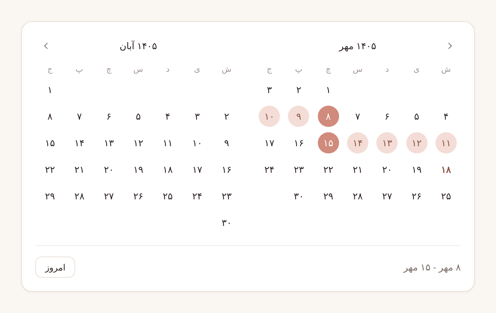
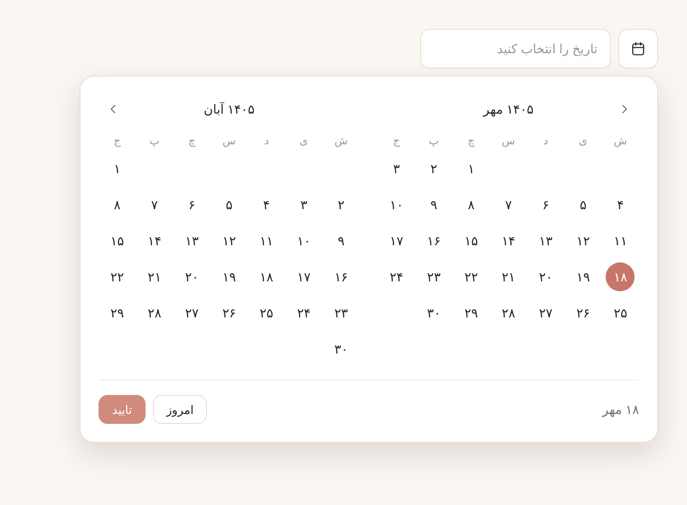
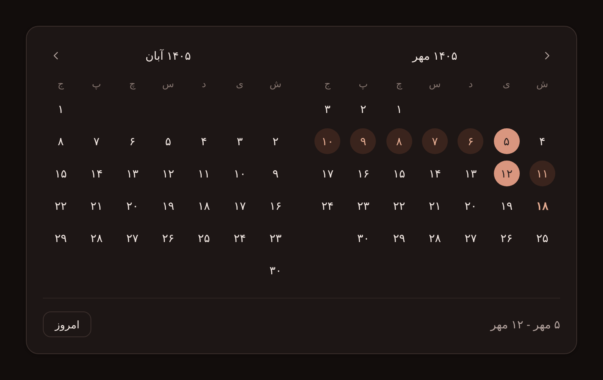
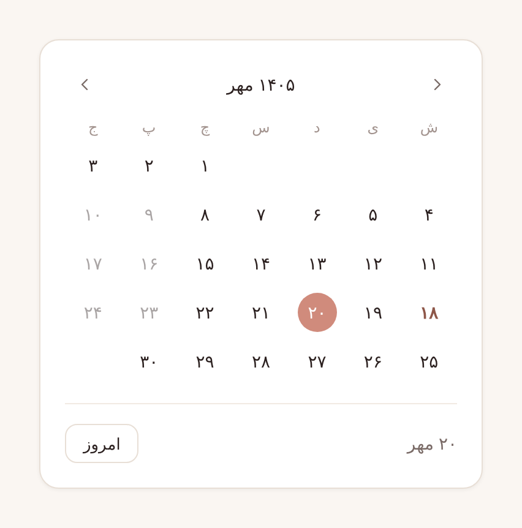
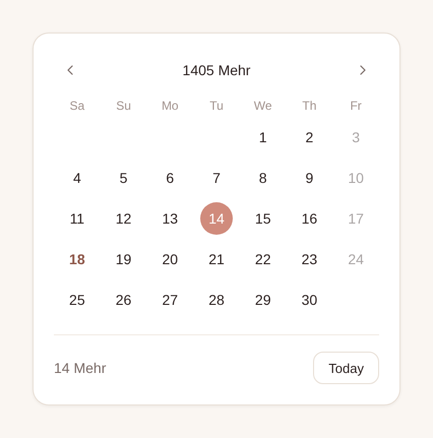

<div align="center">

# 📅 vue-jalali-datepicker

**A lightweight, zero-dependency Persian (Jalali / Shamsi) date & range picker for Vue 3.**

RTL-first · Fully typed · Themeable with CSS variables · ~6 kB gzipped

[](https://www.npmjs.com/package/vue-jalali-datepicker)
[](https://www.npmjs.com/package/vue-jalali-datepicker)
[](https://bundlephobia.com/package/vue-jalali-datepicker)
[](https://github.com/Ariaaghakhani/vue-jalali-datepicker/actions/workflows/ci.yml)
[](./LICENSE)
[](https://vuejs.org)

<br />



</div>

---

## Table of contents

- [Why this picker?](#why-this-picker)
- [Gallery](#gallery)
- [Installation](#installation)
- [Quick start](#quick-start)
- [Examples](#examples)
- [API reference](#api-reference)
  - [Props](#props)
  - [Events](#events)
  - [Slots](#slots)
  - [Exposed methods](#exposed-methods)
  - [Types](#types)
- [Localization](#localization)
- [Theming](#theming)
- [Jalali utilities](#jalali-utilities)
- [Working with dates](#working-with-dates)
- [Accessibility](#accessibility)
- [Browser support](#browser-support)
- [FAQ](#faq)
- [Contributing](#contributing)
- [License](#license)

---

## Why this picker?

| | |
| --- | --- |
| 🪶 **Zero dependencies** | Only `vue` as a peer dependency. No moment, no dayjs, no UI framework. |
| 📅 **Single & range** | Pick one date or a start/end range with a live hover preview. |
| 🪟 **Popover or inline** | Ships with a ready-made input + popover, or drop the calendar straight into your layout. |
| 📱 **Responsive by container** | The two-month view collapses to one month based on the space it's given (CSS container queries), not the screen size. |
| 🚫 **Flexible disabling** | `minDate`, `maxDate`, a list of `disabledDates`, or any `isDateDisabled(date)` predicate. |
| 🌐 **Localizable** | Persian and English labels included, every string overridable, Persian or Latin digits. |
| ↔️ **RTL first, LTR ready** | Built for Persian interfaces, works just as well in LTR apps. |
| 🎨 **Themeable** | Every color, radius and shadow is a CSS custom property. A dark theme is built in. |
| 🧮 **Exact conversion** | Closed-form Jalali ↔ Gregorian arithmetic, verified day by day against `Intl`. Doesn't depend on the browser's Persian calendar support. |
| 🟦 **TypeScript** | Written in TypeScript, with full types for props, events and utilities. |
| ⚡ **SSR friendly** | No DOM access during render. Works in Nuxt and other SSR setups. |

---

## Gallery

<table>
  <tr>
    <td align="center" width="50%">
      <br />
      <sub><b>Popover</b> · input + floating calendar with confirm</sub>
    </td>
    <td align="center" width="50%">
      <br />
      <sub><b>Dark theme</b> · range selection</sub>
    </td>
  </tr>
  <tr>
    <td align="center">
      <br />
      <sub><b>Single month</b> · disabled dates</sub>
    </td>
    <td align="center">
      <br />
      <sub><b>LTR + English labels</b> · Latin digits, Fridays disabled</sub>
    </td>
  </tr>
</table>

---

## Installation

```bash
# npm
npm install vue-jalali-datepicker

# pnpm
pnpm add vue-jalali-datepicker

# yarn
yarn add vue-jalali-datepicker

# bun
bun add vue-jalali-datepicker
```

> **Requirements:** Vue `3.3` or newer.

Don't forget the stylesheet. It's shipped separately so you decide where it goes in your CSS cascade:

```ts
import 'vue-jalali-datepicker/style.css'
```

---

## Quick start

### Local registration

```vue
<script setup lang="ts">
import { ref } from 'vue'
import { JalaliDatePicker } from 'vue-jalali-datepicker'
import 'vue-jalali-datepicker/style.css'

const date = ref<Date | null>(null)
</script>

<template>
  <JalaliDatePicker v-model="date" />
</template>
```

### Global registration

```ts
// main.ts
import { createApp } from 'vue'
import { JalaliDatePickerPlugin } from 'vue-jalali-datepicker'
import 'vue-jalali-datepicker/style.css'
import App from './App.vue'

createApp(App)
  .use(JalaliDatePickerPlugin)          // registers <JalaliDatePicker />
  // .use(JalaliDatePickerPlugin, { name: 'DatePicker' })  // or under a custom name
  .mount('#app')
```

### Nuxt 3 / 4

```ts
// plugins/jalali-datepicker.ts
import { JalaliDatePickerPlugin } from 'vue-jalali-datepicker'
import 'vue-jalali-datepicker/style.css'

export default defineNuxtPlugin((nuxtApp) => {
  nuxtApp.vueApp.use(JalaliDatePickerPlugin)
})
```

---

## Examples

### Date range

In range mode `v-model` is an object with `start` and `end`.

```vue
<script setup lang="ts">
import { ref } from 'vue'
import { JalaliDatePicker, type DateRange } from 'vue-jalali-datepicker'

const stay = ref<DateRange>({ start: null, end: null })
</script>

<template>
  <JalaliDatePicker v-model="stay" range />
</template>
```

Clicking a date earlier than the start flips the range for you, and hovering shows a preview of the range before the second click.

### Inline calendar

```vue
<JalaliDatePicker v-model="date" variant="inline" />
```

Inline pickers update `v-model` on every click. There is no confirm step.

### Apply without a confirm button

By default the popover keeps a *draft* until the user presses **تایید** (confirm). With `auto-apply` the value is committed, and the popover closes, as soon as the selection is complete:

```vue
<JalaliDatePicker v-model="stay" range auto-apply />
```

### Limiting selectable dates

```vue
<script setup lang="ts">
const today = new Date()
const inThreeMonths = new Date(today.getFullYear(), today.getMonth() + 3, today.getDate())

const holidays = [new Date(2026, 2, 20), new Date(2026, 2, 21)]

// Disable every Friday
const isFriday = (date: Date) => date.getDay() === 5
</script>

<template>
  <JalaliDatePicker
    v-model="date"
    :min-date="today"
    :max-date="inThreeMonths"
    :disabled-dates="holidays"
    :is-date-disabled="isFriday"
  />
</template>
```

All four options can be combined. A day is disabled if *any* of them says so.

### One month only

```vue
<JalaliDatePicker v-model="date" :months="1" />
```

### English labels, Latin digits, LTR layout

```vue
<script setup lang="ts">
import { JalaliDatePicker, enLocale } from 'vue-jalali-datepicker'
</script>

<template>
  <JalaliDatePicker v-model="date" :locale="enLocale" digits="latin" :rtl="false" />
</template>
```

### Custom label format

```vue
<script setup lang="ts">
import { toFaDigits, faLocale, type JalaliDate } from 'vue-jalali-datepicker'

// e.g. "۱۴۰۵/۰۷/۱۸"
const formatDate = (_date: Date, j: JalaliDate) =>
  toFaDigits(`${j.jy}/${String(j.jm).padStart(2, '0')}/${String(j.jd).padStart(2, '0')}`)
</script>

<template>
  <JalaliDatePicker v-model="date" :format-date="formatDate" />
</template>
```

### Custom trigger

Replace the built-in input and button with any element through the `trigger` slot:

```vue
<JalaliDatePicker v-model="date">
  <template #trigger="{ toggle, open, label, placeholder }">
    <button type="button" class="my-button" :aria-expanded="open" @click="toggle">
      📅 {{ label ?? placeholder }}
    </button>
  </template>
</JalaliDatePicker>
```

### Controlling the popover from code

```vue
<script setup lang="ts">
import { ref } from 'vue'
import { JalaliDatePicker } from 'vue-jalali-datepicker'

const picker = ref<InstanceType<typeof JalaliDatePicker>>()
</script>

<template>
  <JalaliDatePicker ref="picker" v-model="date" />
  <button @click="picker?.open()">Pick a date</button>
</template>
```

### Inside a form

The built-in input is `readonly` and accepts a `name`. Send whatever format your backend expects through a hidden field:

```vue
<form @submit.prevent="submit">
  <JalaliDatePicker v-model="birthday" name="birthday-label" />
  <input type="hidden" name="birthday" :value="birthday?.toISOString() ?? ''" />
</form>
```

### Reacting to every click

`select-date` fires on every day click, even while a popover selection is still a draft. This is useful for analytics or for loading availability:

```vue
<JalaliDatePicker v-model="date" @select-date="(d) => loadSlots(d)" />
```

---

## API reference

### Props

| Prop | Type | Default | Description |
| --- | --- | --- | --- |
| `modelValue` | `Date \| null \| DateRange` | `null` | Selected value. `Date \| null` in single mode, `{ start, end }` in range mode. |
| `range` | `boolean` | `false` | Enables start/end range selection. |
| `variant` | `'popover' \| 'inline'` | `'popover'` | `popover` renders an input with a floating calendar. `inline` renders only the calendar. |
| `months` | `1 \| 2` | `2` | Months displayed side by side. With `2`, the second month hides automatically when the calendar has less than ~560px. |
| `placeholder` | `string` | from locale | Placeholder of the built-in input. |
| `minDate` | `Date \| null` | `null` | Earliest selectable day (inclusive). |
| `maxDate` | `Date \| null` | `null` | Latest selectable day (inclusive). |
| `disabledDates` | `Date[]` | `[]` | Specific days that can't be selected. Only the calendar day matters, not the time. |
| `isDateDisabled` | `(date: Date) => boolean` | — | Predicate for custom rules (weekends, fully-booked days, …). |
| `locale` | `Partial<DatePickerLocale>` | `faLocale` | Override any label. Missing keys fall back to Persian. |
| `digits` | `'fa' \| 'latin'` | `'fa'` | Render numbers as `۱۲۳` or `123`. |
| `rtl` | `boolean` | `true` | Layout direction of the calendar. |
| `autoApply` | `boolean` | `false` | *Popover only.* Commit and close as soon as the selection is complete. Hides the confirm button. |
| `showToday` | `boolean` | `true` | Show the "Today" button in the footer. |
| `showFooter` | `boolean` | `true` | *Inline only.* Show the footer with the selection summary and the "Today" button. |
| `align` | `'start' \| 'end'` | `'start'` | Popover alignment relative to the trigger (logical, so it follows `dir`). |
| `disabled` | `boolean` | `false` | Disables the built-in trigger. |
| `name` | `string` | — | `name` attribute for the built-in input. |
| `formatDate` | `(date: Date, jalali: JalaliDate) => string` | — | Custom label for selected dates. Defaults to `<day> <month>`, e.g. `۱۸ مهر`. |

### Events

| Event | Payload | Fired when |
| --- | --- | --- |
| `update:modelValue` | `DatePickerValue` | The value is committed: on every click for inline, on confirm (or auto-apply) for popover. |
| `confirm` | `DatePickerValue` | The user confirms a popover selection. |
| `select-date` | `Date` | Any day is clicked, or "Today" is pressed, whether or not the value is committed yet. |
| `open` | — | The popover opens. |
| `close` | — | The popover closes (confirm, outside click, <kbd>Esc</kbd>, or `close()`). |

### Slots

| Slot | Props | Description |
| --- | --- | --- |
| `trigger` | `{ open: boolean, toggle: () => void, label: string \| null, placeholder: string }` | Replaces the built-in input and button of the popover variant. `label` is the formatted committed value, or `null` when nothing is selected. |

### Exposed methods

Available through a template ref:

| Method | Description |
| --- | --- |
| `open()` | Opens the popover. The draft resets to the current `modelValue`. |
| `close()` | Closes the popover and discards the draft. |
| `toggle()` | Toggles the popover (no-op when `disabled`). |

### Types

```ts
import type {
  DateRange,        // { start: Date | null; end: Date | null }
  DatePickerValue,  // Date | null | DateRange
  DatePickerLocale, // all translatable strings (see below)
  JalaliDate,       // { jy: number; jm: number; jd: number }
  JalaliMonth,      // { jy: number; jm: number }
} from 'vue-jalali-datepicker'
```

---

## Localization

Two locales are included:

```ts
import { faLocale, enLocale } from 'vue-jalali-datepicker'
```

Pass a full locale or override only what you need. Missing keys fall back to `faLocale`:

```vue
<JalaliDatePicker
  v-model="date"
  :locale="{ confirm: 'ثبت', today: 'برو به امروز', placeholder: 'تاریخ نوبت' }"
/>
```

<details>
<summary><b>All locale keys</b></summary>

| Key | Persian default | English (`enLocale`) |
| --- | --- | --- |
| `months` | `['فروردین', …, 'اسفند']` | `['Farvardin', …, 'Esfand']` |
| `weekdays` | `['ش', 'ی', 'د', 'س', 'چ', 'پ', 'ج']` | `['Sa', 'Su', 'Mo', 'Tu', 'We', 'Th', 'Fr']` |
| `toggleLabel` | باز کردن تقویم | Open calendar |
| `placeholder` | تاریخ را انتخاب کنید | Select a date |
| `rangePlaceholder` | بازه تاریخ را انتخاب کنید | Select a date range |
| `emptySummary` | تاریخ را انتخاب کنید | Select a date |
| `emptyRangeSummary` | تاریخ شروع و پایان را انتخاب کنید | Select start and end dates |
| `today` | امروز | Today |
| `confirm` | تایید | Confirm |
| `prevMonth` | ماه قبل | Previous month |
| `nextMonth` | ماه بعد | Next month |
| `rangeSeparator` | `' - '` | `' – '` |

`weekdays` always starts on **Saturday**, following the Persian week.

</details>

With **vue-i18n**, build the locale from your messages:

```vue
<script setup lang="ts">
import { computed } from 'vue'
import { useI18n } from 'vue-i18n'

const { t } = useI18n()
const pickerLocale = computed(() => ({ today: t('picker.today'), confirm: t('picker.confirm') }))
</script>

<template>
  <JalaliDatePicker v-model="date" :locale="pickerLocale" />
</template>
```

---

## Theming

The default look is a neutral, soft "rose" palette. Everything is driven by CSS custom properties defined on `.vjdp-calendar` and `.vjdp-popover`, so you can retheme it from any ancestor without fighting specificity.

```css
/* Brand it once, app-wide */
.vjdp-calendar,
.vjdp-popover {
  --vjdp-accent: #2563eb;
  --vjdp-accent-hover: #1d4ed8;
  --vjdp-accent-soft: #dbeafe;
  --vjdp-accent-fg: #1e40af;
  --vjdp-radius: 12px;
  --vjdp-font-family: 'Vazirmatn', sans-serif;
}

/* …or scope a variant to one part of your app */
.checkout .vjdp-calendar,
.checkout .vjdp-popover {
  --vjdp-accent: #16a34a;
}
```

<details open>
<summary><b>CSS variables</b></summary>

| Variable | Default (light) | Purpose |
| --- | --- | --- |
| `--vjdp-font-family` | `inherit` | Font of the whole component |
| `--vjdp-bg` | `#ffffff` | Surface background |
| `--vjdp-bg-hover` | `#f5efe8` | Hover background of days and buttons |
| `--vjdp-fg` | `#2a1f1e` | Primary text |
| `--vjdp-fg-muted` | `#7a6b67` | Secondary text (summary, nav icons) |
| `--vjdp-fg-subtle` | `#a3948f` | Weekday names, placeholder |
| `--vjdp-border` | `#e8dfd6` | Surface, input and button borders |
| `--vjdp-border-faint` | `#f1eae3` | Footer divider |
| `--vjdp-accent` | `#d08b7c` | Selected day, primary button |
| `--vjdp-accent-hover` | `#c77669` | Hover state of the accent |
| `--vjdp-accent-soft` | `#f4ddd6` | Days inside a range |
| `--vjdp-accent-fg` | `#8e5749` | Today's number, text inside a range |
| `--vjdp-on-accent` | `#ffffff` | Text on the accent color |
| `--vjdp-radius` | `16px` | Calendar corner radius |
| `--vjdp-radius-control` | `10px` | Input and button radius |
| `--vjdp-shadow` | subtle | Inline calendar shadow |
| `--vjdp-shadow-elevated` | soft drop | Popover shadow |
| `--vjdp-width` | `640px` / `320px` | Calendar width with two / one month(s) |
| `--vjdp-z-index` | `50` | Popover stacking order |
| `--vjdp-transition` | `150ms ease` | Hover transitions (`0s` under `prefers-reduced-motion`) |

</details>

### Dark mode

Dark colors switch on when an ancestor has the **`dark`** class (the convention used by Tailwind, Nuxt Color Mode, VueUse `useDark`, …) or the **`vjdp-dark`** class:

```html
<html class="dark"> … </html>

<!-- or just one picker -->
<div class="vjdp-dark">
  <JalaliDatePicker v-model="date" />
</div>
```

Following the OS setting instead:

```css
@media (prefers-color-scheme: dark) {
  .vjdp-calendar,
  .vjdp-popover {
    --vjdp-bg: #1d1615;
    --vjdp-fg: #f3e9e4;
    /* …override the other variables as needed */
  }
}
```

### Class hooks

For anything the variables don't cover, every part has a stable, BEM-style class:

`.vjdp-popover` · `.vjdp-trigger` · `.vjdp-input` · `.vjdp-popover__panel` · `.vjdp-calendar` · `.vjdp-month` · `.vjdp-month__title` · `.vjdp-nav` · `.vjdp-weekdays` · `.vjdp-day` · `.vjdp-day--selected` · `.vjdp-day--in-range` · `.vjdp-day--today` · `.vjdp-footer` · `.vjdp-btn` · `.vjdp-btn--primary`

---

## Jalali utilities

The conversion helpers the picker uses are exported too, so you don't need a separate date library for simple Jalali work:

```ts
import {
  toJalali,
  toGregorian,
  isJalaliLeapYear,
  jalaliMonthLength,
  jalaliFirstWeekday,
  shiftJalaliMonth,
  toFaDigits,
} from 'vue-jalali-datepicker'

toJalali(new Date(2025, 2, 21))              // { jy: 1404, jm: 1, jd: 1 }
toGregorian({ jy: 1404, jm: 1, jd: 1 })      // Date → Fri Mar 21 2025 00:00 (local)
isJalaliLeapYear(1403)                       // true
jalaliMonthLength(1404, 12)                  // 29
jalaliFirstWeekday(1404, 1)                  // 6  (0 = Saturday … 6 = Friday)
shiftJalaliMonth({ jy: 1404, jm: 12 }, 1)    // { jy: 1405, jm: 1 }
toFaDigits('1404/01/01')                     // '۱۴۰۴/۰۱/۰۱'
```

| Function | Signature | Notes |
| --- | --- | --- |
| `toJalali` | `(date: Date) => JalaliDate` | Reads the date in **local** time. |
| `toGregorian` | `(date: JalaliDate) => Date` | Returns **local midnight**. |
| `isJalaliLeapYear` | `(jy: number) => boolean` | 33-year cycle based arithmetic. |
| `jalaliMonthLength` | `(jy: number, jm: number) => number` | 31 / 30 / 29–30 (Esfand). |
| `jalaliFirstWeekday` | `(jy: number, jm: number) => number` | Saturday-first index of day 1. |
| `jalaliKey` | `(date: JalaliDate) => number` | Comparable integer, handy for sorting and equality. |
| `shiftJalaliMonth` | `(month: JalaliMonth, delta: number) => JalaliMonth` | Moves across year boundaries correctly. |
| `toFaDigits` | `(value: number \| string) => string` | Converts `0-9` to `۰-۹`. |

The conversion is a closed-form implementation of the Borkowski algorithm, valid for Jalali years **-61 to 3177**. It's tested against `Intl`'s Persian calendar for every single day between 1991 and 2051.

---

## Working with dates

- **Values are plain `Date` objects at local midnight.** The picker works with *calendar days*, so the time part of any `Date` you pass in is ignored.
- **Sending to an API?** Serialize the way your backend expects. For a pure date, avoid `toISOString()` (it converts to UTC and can shift the day in positive-offset time zones such as Asia/Tehran). Prefer something like:

  ```ts
  const toYmd = (d: Date) =>
    `${d.getFullYear()}-${String(d.getMonth() + 1).padStart(2, '0')}-${String(d.getDate()).padStart(2, '0')}`
  ```

- **Range values are always ordered.** `start <= end` once both are set, whichever order the user clicked in.
- **Popover drafts.** While the popover is open the selection is a draft. `modelValue` only changes on confirm (or `auto-apply`). Closing without confirming discards the draft.

---

## Accessibility

- Every control is a native `<button>`, so you get keyboard focus and activation for free, with visible `:focus-visible` rings.
- The navigation buttons and calendar toggle have localized `aria-label`s.
- Today's date has `aria-current="date"`, and selected days have `aria-selected="true"`.
- The trigger button reports its state through `aria-expanded`, and <kbd>Esc</kbd> closes the popover.
- Disabled days use the native `disabled` attribute.
- Transitions are switched off under `prefers-reduced-motion: reduce`.

---

## Browser support

All evergreen browsers. The responsive two-month layout uses [CSS container queries](https://caniuse.com/css-container-queries) (Chrome/Edge 105+, Safari 16+, Firefox 110+). Older browsers still get a fully working single-month layout.

---

## FAQ

<details>
<summary><b>The popover is clipped inside a scrolling container or modal.</b></summary>

The popover is positioned absolutely relative to the picker, so an ancestor with `overflow: hidden` can clip it. Give that container enough room, set `overflow: visible`, or use `variant="inline"` inside your own popover/dialog component.

</details>

<details>
<summary><b>Can I use it with Nuxt UI, Vuetify, PrimeVue, Tailwind…?</b></summary>

Yes. The component has no styling dependencies. Use the `trigger` slot to render your design system's input or button, and map your design tokens onto the `--vjdp-*` variables.

</details>

<details>
<summary><b>Does it support time selection?</b></summary>

Not yet. The picker works with calendar days. Pair it with your own time input and combine the values.

</details>

<details>
<summary><b>Can the week start on a different day?</b></summary>

The Persian week starts on Saturday, and the grid always follows that. Feel free to open an issue if you need a configurable first weekday.

</details>

<details>
<summary><b>Why not just use <code>Intl</code> for the Jalali conversion?</b></summary>

`Intl` can *format* dates in the Persian calendar but can't *construct* them, so converting back requires a search, and support varies between runtimes. The closed-form arithmetic used here is exact, fast, and behaves the same everywhere.

</details>

---

## Contributing

Issues and pull requests are welcome! 🙌

```bash
git clone https://github.com/Ariaaghakhani/vue-jalali-datepicker.git
cd vue-jalali-datepicker
npm install

npm run dev        # interactive playground (playground/App.vue)
npm test           # unit tests (Vitest)
npm run typecheck  # vue-tsc
npm run build      # library build → dist/
```

**Project layout**

```
src/
├── components/
│   ├── JalaliDatePicker.vue    # public component: state, popover, v-model
│   ├── DatePickerCalendar.vue  # month grid(s) + footer
│   └── DatePickerMonth.vue     # a single month
├── jalali.ts                   # conversion & calendar utilities
├── locale.ts                   # faLocale / enLocale
├── types.ts
├── style.css                   # all styles & CSS variables
└── index.ts                    # public exports + plugin
```

Before opening a PR, please make sure `npm run typecheck`, `npm test` and `npm run build` all pass. CI runs the same checks.

**Releasing** (maintainers): bump the version in `package.json`, then publish a GitHub release. The [publish workflow](.github/workflows/publish.yml) builds the package and publishes it to npm with provenance, using the `NPM_TOKEN` repository secret.

---

## License

[MIT](./LICENSE) © [Aria Aghakhani](https://www.dev-aria.com)

<div align="center">
<sub>Made with ❤️ for the Persian-speaking Vue community.</sub>
</div>
